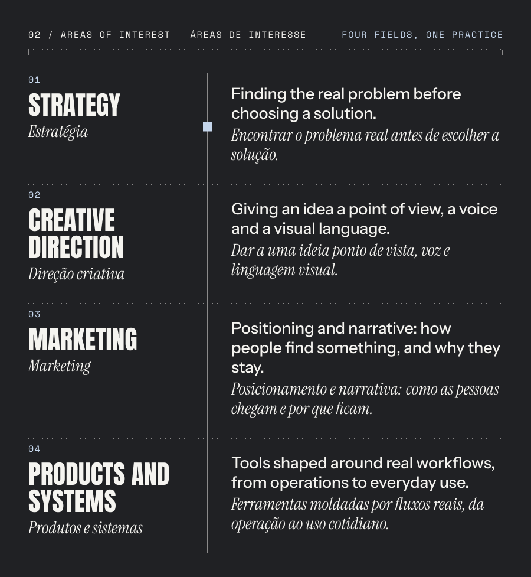
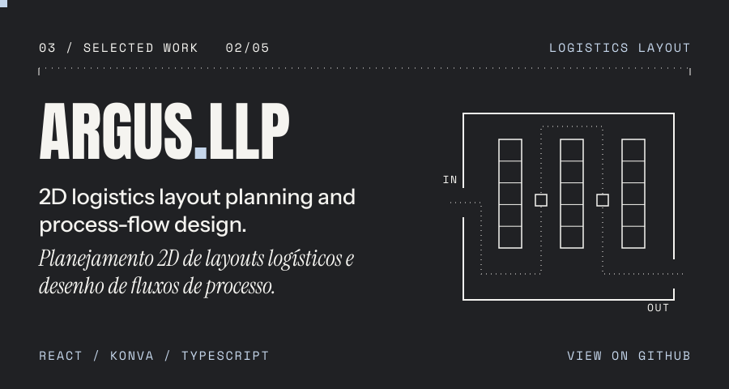
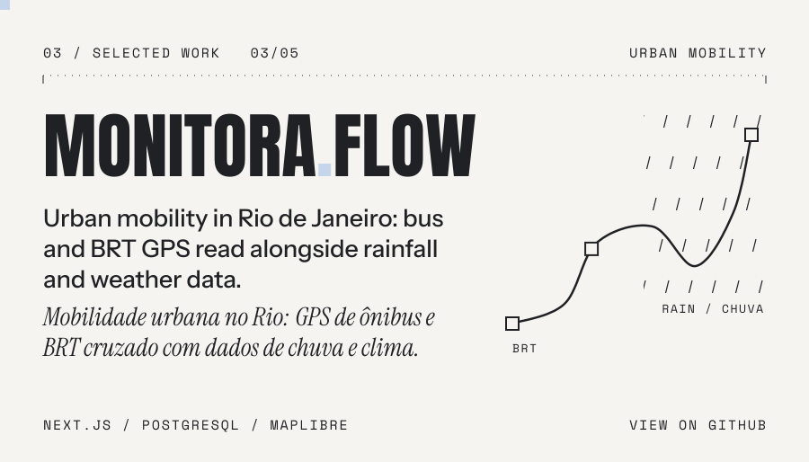
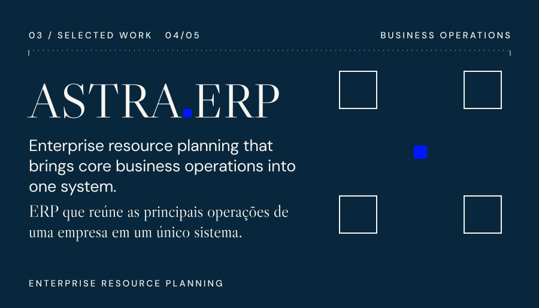
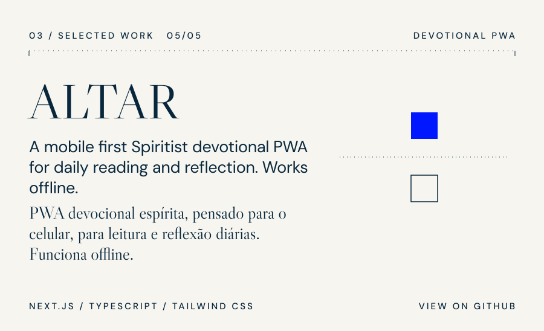
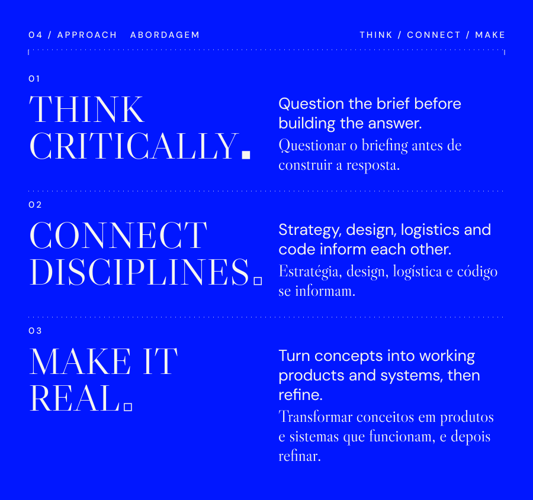
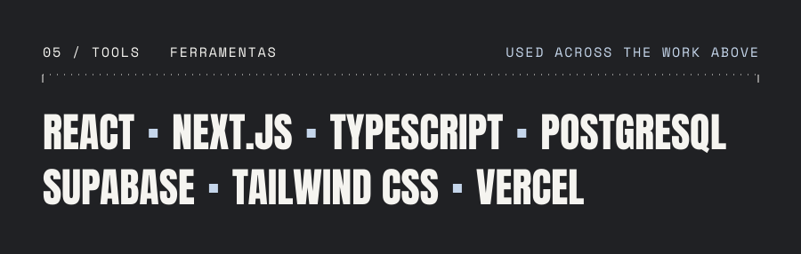

<a href="https://marcusvalerio.vercel.app"><b>marcusvalerio.vercel.app ↗</b></a>

<a href="https://fadeos-five.vercel.app">Live demo ↗</a> &nbsp;·&nbsp; <a href="https://github.com/marcusvalerio/fade.os">Source ↗</a>

<a href="https://github.com/marcusvalerio/FLUXOCIT.LLP">Source ↗</a>

<a href="https://monitora-flow.vercel.app">Live demo ↗</a> &nbsp;·&nbsp; <a href="https://github.com/marcusvalerio/monitora.flow">Source ↗</a>

<a href="https://altar-teal.vercel.app">Live demo ↗</a> &nbsp;·&nbsp; <a href="https://github.com/marcusvalerio/Altar">Source ↗</a>

**Build. Learn. Improve.**

