**EN** · Product builder creating digital products for real-world workflows.  
**PT** · Desenvolvo produtos digitais para transformar processos reais em sistemas úteis.

---

## Selected work / Projetos em destaque

<table>
<tr>
<td width="50%" valign="top">

### [CÓRTEX.OS ↗](https://github.com/marcusvalerio/fade.os)

**EN** · Barbershop management.  
**PT** · Gestão para barbearias.

[Live demo](https://fadeos-five.vercel.app) · [Source](https://github.com/marcusvalerio/fade.os)

</td>
<td width="50%" valign="top">

### [ARGUS.LLP ↗](https://github.com/marcusvalerio/FLUXOCIT.LLP)

**EN** · 2D logistics layout planning and process-flow design.  
**PT** · Planejamento 2D de layouts logísticos e fluxos de processos.

[Source code](https://github.com/marcusvalerio/FLUXOCIT.LLP)

</td>
</tr>
<tr>
<td width="50%" valign="top">

### [MONITORA.FLOW ↗](https://github.com/marcusvalerio/monitora.flow)

**EN** · Urban mobility, bus/BRT GPS, rainfall and weather data.  
**PT** · Mobilidade urbana, GPS de ônibus/BRT, chuva e clima.

[Live demo](https://monitora-flow.vercel.app) · [Source](https://github.com/marcusvalerio/monitora.flow)

</td>
<td width="50%" valign="top">

### [SENTINEL ↗](https://github.com/marcusvalerio/SENTINEL)

**EN** · Project context, decisions, milestones and progress.  
**PT** · Contexto de projetos, decisões, marcos e progresso.

[Live demo](https://sentinel-ashy-alpha.vercel.app) · [Source](https://github.com/marcusvalerio/SENTINEL)

</td>
</tr>
<tr>
<td colspan="2" valign="top">

### [ALTAR ↗](https://github.com/marcusvalerio/Altar)

**EN** · A mobile-first Spiritist devotional PWA for reading and reflection.  
**PT** · PWA devocional espírita, mobile-first, para leitura e reflexão.

[Live demo](https://altar-teal.vercel.app) · [Source](https://github.com/marcusvalerio/Altar)

</td>
</tr>
</table>

---

## Approach / Abordagem

| EN | PT |
|:--|:--|
| **Product thinking** — start with the real problem. | **Pensamento de produto** — começar pelo problema real. |
| **Systems thinking** — understand workflows and constraints. | **Pensamento sistêmico** — compreender fluxos e restrições. |
| **Build & refine** — turn ideas into working software. | **Construir e refinar** — transformar ideias em software funcional. |

## Technology

---

**MARCUS VALÉRIO.**  
Build. Learn. Improve.

Fluid Blue · Off-white · Charcoal

