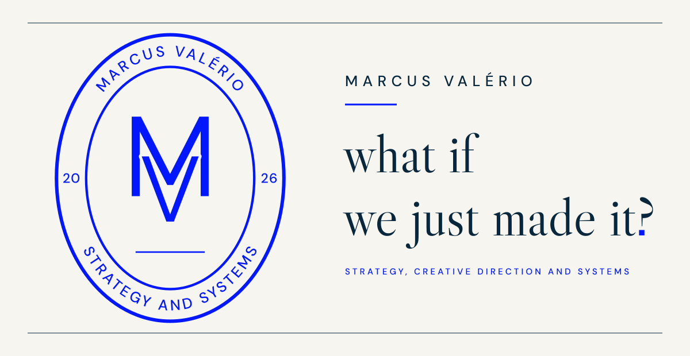
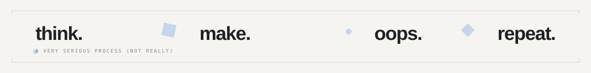

<a href="https://marcusvalerio.vercel.app"><b>marcusvalerio.vercel.app ↗</b></a>

 

## About · <i>Sobre</i>

I'm a creative thinker who likes the moment an idea becomes something real. I connect strategy, marketing, design and technology to build products and systems that solve real problems.

<i>Sou movido por ideias e pelo momento em que elas viram algo real. Conecto estratégia, marketing, design e tecnologia para criar produtos e sistemas que resolvem problemas reais.</i>

> **Now** · I study logistics, which shapes how I think about processes, operations and systems. 
> <i>**Agora** · Estudo logística, o que molda minha forma de pensar processos, operações e sistemas.</i>

 

## Areas of interest · <i>Áreas de interesse</i>

* **Strategy** · <i>Estratégia</i> 
  Finding the real problem before choosing a solution. 
  <i>Encontrar o problema real antes de escolher a solução.</i>

* **Creative direction** · <i>Direção criativa</i> 
  Giving an idea a point of view, a voice and a visual language. 
  <i>Dar a uma ideia ponto de vista, voz e linguagem visual.</i>

* **Marketing** 
  Positioning and narrative: how people find something, and why they stay. 
  <i>Posicionamento e narrativa: como as pessoas chegam e por que ficam.</i>

* **Products and systems** · <i>Produtos e sistemas</i> 
  Tools shaped around real workflows, from operations to everyday use. 
  <i>Ferramentas moldadas por fluxos reais, da operação ao uso cotidiano.</i>

 

## Selected work · <i>Projetos em destaque</i>

### CÓRTEX.OS
An operating system for barbershops: agenda, service, cash, commission and stock, at the counter and on every barber's phone. 
<i>Sistema operacional para barbearias: agenda, atendimento, caixa, comissão e estoque, no balcão e no celular de cada barbeiro.</i>

`Next.js` `Supabase` `TypeScript`

[Live demo ↗](https://fadeos-five.vercel.app) &nbsp;·&nbsp; [Source ↗](https://github.com/marcusvalerio/fade.os)

### ARGUS.LLP
2D logistics layout planning and process flow design, with occupancy, capacity and bottleneck metrics calculated as you draw. 
<i>Planejamento 2D de layouts logísticos e desenho de fluxos de processo, com métricas de ocupação, capacidade e gargalo calculadas enquanto você desenha.</i>

`React` `Konva` `TypeScript`

[Source ↗](https://github.com/marcusvalerio/FLUXOCIT.LLP)

### MONITORA.FLOW
Urban mobility in Rio de Janeiro: bus and BRT GPS read alongside rainfall and weather data. 
<i>Mobilidade urbana no Rio de Janeiro: GPS de ônibus e BRT cruzado com dados de chuva e clima.</i>

`Next.js` `PostgreSQL` `MapLibre`

[Live demo ↗](https://monitora-flow.vercel.app) &nbsp;·&nbsp; [Source ↗](https://github.com/marcusvalerio/monitora.flow)

### ASTRA.ERP
Enterprise resource planning that brings core business operations into one system. 
<i>ERP que reúne as principais operações de uma empresa em um único sistema.</i>

### ALTAR
A Spiritist devotional PWA designed for the phone, for a few daily minutes of reading and reflection. Works offline, no login. 
<i>PWA devocional espírita pensado para o celular, para alguns minutos diários de leitura e reflexão. Funciona offline e sem login.</i>

`Next.js` `TypeScript` `Tailwind CSS`

[Live demo ↗](https://altar-teal.vercel.app) &nbsp;·&nbsp; [Source ↗](https://github.com/marcusvalerio/Altar)

 

## Approach · <i>Abordagem</i>

1. **Think critically.** Question the brief before building the answer. 
   <i>**Pensar criticamente.** Questionar o briefing antes de construir a resposta.</i>

2. **Connect disciplines.** Strategy, design, logistics and code inform each other. 
   <i>**Conectar áreas.** Estratégia, design, logística e código se informam.</i>

3. **Make it real.** Turn concepts into working products and systems, then refine. 
   <i>**Tirar do papel.** Transformar conceitos em produtos e sistemas que funcionam, e depois refinar.</i>

 

## Tools · <i>Ferramentas</i>

`React` `Next.js` `TypeScript` `PostgreSQL` `Supabase` `Tailwind CSS` `Vercel`

 

**Build. Learn. Improve.**

